<div align="center">

  <a href="https://nexdevstudios.vercel.app/">
    
  </a>

  <p>
    Un reproductor IPTV moderno, fluido y de alto rendimiento para dispositivos móviles Android.
    <br />
    Construido con Kotlin Multiplatform y Jetpack Compose (Material You).
  </p>

  <p>
    <a href="https://nexdevstudios.vercel.app/"><strong>🌐 Sitio Web Oficial</strong></a> &nbsp;•&nbsp; <a href="https://github.com/NexDevStudios-repo/neXStream/releases/latest"><strong>📥 Descargar APK (GitHub Releases)</strong></a>
  </p>

</div>

---

## 📖 Origen y Por Qué un Fork de Nuvio

**neXStream** nació como un fork de **Nuvio Mobile**, un reproductor multimedia de código abierto con una arquitectura excepcional.

### ¿Por qué elegimos la base de Nuvio?
* **Arquitectura de Interfaz de Primer Nivel:** Nuvio contaba con uno de los sistemas de UI más modernos del ecosistema Kotlin Multiplatform, utilizando Jetpack Compose con tokens de Material You, animaciones fluidas y un diseño táctil adaptativo optimizado para dispositivos móviles.
* **Motor de Reproducción Robusto:** Un pipeline multimedia maduro basado en ExoPlayer, con aceleración por hardware, soporte de subtítulos avanzados, cambio de pistas de audio y Picture-in-Picture (PiP).
* **Sistema de Actualización In-App:** Un sistema nativo de auto-actualizaciones a través de la API de GitHub Releases, permitiendo distribuir la app directamente sin depender de tiendas cerradas.

---

## 🔄 Transformación: ¿Qué cambió respecto a Nuvio?

Nuvio fue concebido originalmente como un agregador de medios con plugins externos, torrents y servicios debrid. En **neXStream** transformamos por completo esa visión para crear un **reproductor IPTV puro, veloz y especializado**:

### ✂️ Lo que se removió
* **Desmantelamiento de P2P y Debrid:** Se eliminaron por completo los motores de torrents (P2P), clientes debrid (Real-Debrid, TorBox, Premiumize) y el entorno de ejecución de plugins (JS/WASM).
* **Eliminación de dependencias innecesarias:** Al retirar componentes no relacionados con IPTV, se redujo el consumo de batería, la sobrecarga en memoria y el peso del APK.

### 🚀 Lo que se implementó
* **Integración Nativa con Xtream Codes:** Soporte directo y completo para la API de Xtream Codes (Canales en Vivo, Películas VOD, Series por temporadas/episodios y EPG).
* **Soporte para Listas M3U:** Parser optimizado para listas de reproducción en formato M3U/M3U8.
* **Cajón de Canales en Vivo en Reproducción:** Panel lateral interactivo (`PlayerChannelsPanel`) que permite explorar categorías y cambiar de canal al instante sin interrumpir la transmisión en pantalla.
* **Actualizaciones dedicadas de neXStream:** Reconfiguración total del sistema de actualizaciones para consultar directamente los releases de `NexDevStudios-repo/neXStream`.

### ⚡ Lo que se mejoró y optimizó
* **Afinamiento del Motor de Streaming:** Buffers y cachés de ExoPlayer optimizados para flujos HLS y MPEG-TS típicos de IPTV, reduciendo el retardo y el buffering inicial.
* **Corrección de Cuadrículas y Pósters:** Ajuste de medidas y ratios de aspecto en las portadas de VOD para evitar distorsiones y espacios vacíos en distintas resoluciones.
* **Interfaz y Temas Personalizados:** Integración de paletas temáticas dinámicas (Arctic Blue, Emerald, Rose Gold, Copper, Graphite) con soporte completo para Material Design 3 Expressive.

---

## ✨ Características Principales

- 📡 **Xtream Codes & M3U:** Conexión directa a tus servidores IPTV con soporte de credenciales seguras.
- 📺 **Canales en Vivo & VOD Separados:** Catálogos independientes con navegación organizada por categorías.
- 🎨 **Material You & Jetpack Compose:** Interfaz moderna que se adapta a los colores de tu sistema.
- ⚡ **ExoPlayer con Aceleración Hardware:** Calidad óptima y bajo consumo de recursos.
- 🔄 **Actualizador Integrado:** Alerta y descarga de nuevas versiones directamente desde GitHub.
- 🔒 **100% Privado:** Tu contenido, tus servidores. Sin telemetría invasiva ni anuncios.

---

## 📥 Instalación

Descarga el último APK desde la sección de **[Releases](https://github.com/NexDevStudios-repo/neXStream/releases)**:

1. Descarga el archivo `.apk` correspondiente a tu dispositivo (o la versión universal).
2. Instálalo permitiendo fuentes desconocidas si tu sistema lo solicita.
3. Abre la app e ingresa la URL y credenciales de tu servicio Xtream Codes.

---

## 🛠️ Compilación desde el código fuente

Requiere JDK 17 y Android SDK:

```bash
git clone https://github.com/NexDevStudios-repo/neXStream.git
cd neXStream
./gradlew :androidApp:assembleFullRelease
```

---

## 🌐 Comunidad y Soporte Oficial

* 📸 **Instagram:** [@nexdevstudios_](https://instagram.com/nexdevstudios_)
* ✖️ **X (Twitter):** [@nexdevstudios_](https://x.com/nexdevstudios_)
* 💬 **Canal Oficial de Telegram:** [Unirse al canal](https://t.me/+C_ZyoLwgMi1iNjRh)
* ✉️ **Correo de Soporte:** [soportenexdevstudiosoficial@gmail.com](mailto:soportenexdevstudiosoficial@gmail.com)

---

## 📄 Licencia y Atribución

Este proyecto es software libre bajo la licencia **GNU General Public License v3.0** ([GPL-3.0](./LICENSE)).  
Para detalles sobre créditos al proyecto original Nuvio, consulta [NOTICE.md](./NOTICE.md).
